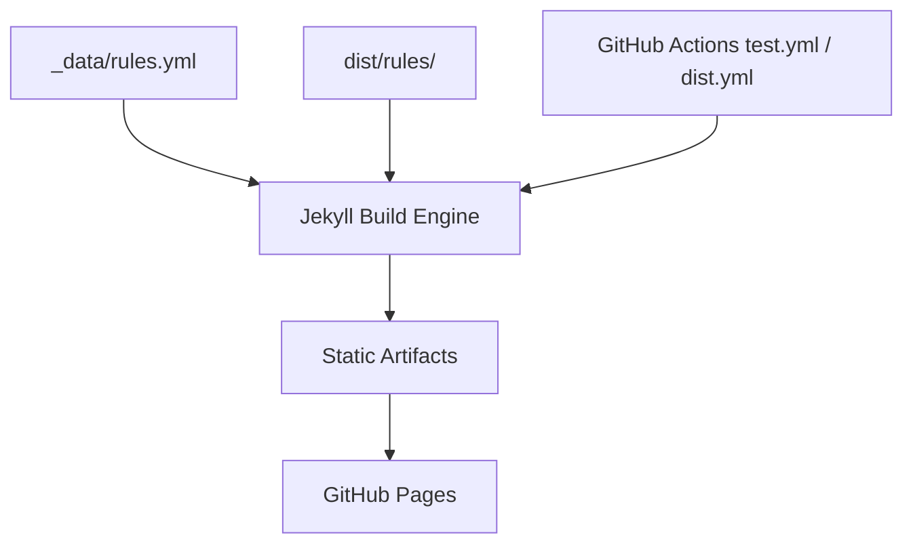

# samber/awesome-prometheus-alerts

> Collection of copy-ready Prometheus alerting rules in YAML, for more than 90 services.

## The problem
Writing Prometheus alerting rules from scratch for every database, broker or orchestrator is slow and easy to get incomplete.

## What it actually does
A catalog of more than 1,155 rules for 93 services (host, MySQL, PostgreSQL, Redis, Kafka, Kubernetes, Spark, Flink, LiteLLM, etc.), published as a static Jekyll site on GitHub Pages. You copy the YAML you want into your config.

## How it is wired

## Trying it
No command documented in the README. The catalog can be browsed at https://samber.github.io/awesome-prometheus-alerts.

## Cost and gotchas
Free. The rules are starting points: thresholds and labels must be adapted to your environment, otherwise alert noise. The README mentions sponsors.

## What it is not
Not an installable tool nor a metrics exporter: you already need Prometheus and the exporters. License present but not identified by GitHub.

## Alternatives
No alternative named in the README.

## For you
Adopt as a reference: for MLOps observability (Kubernetes, Kafka, Spark, LiteLLM), it is an immediate time saver, to be reviewed before deploying.
