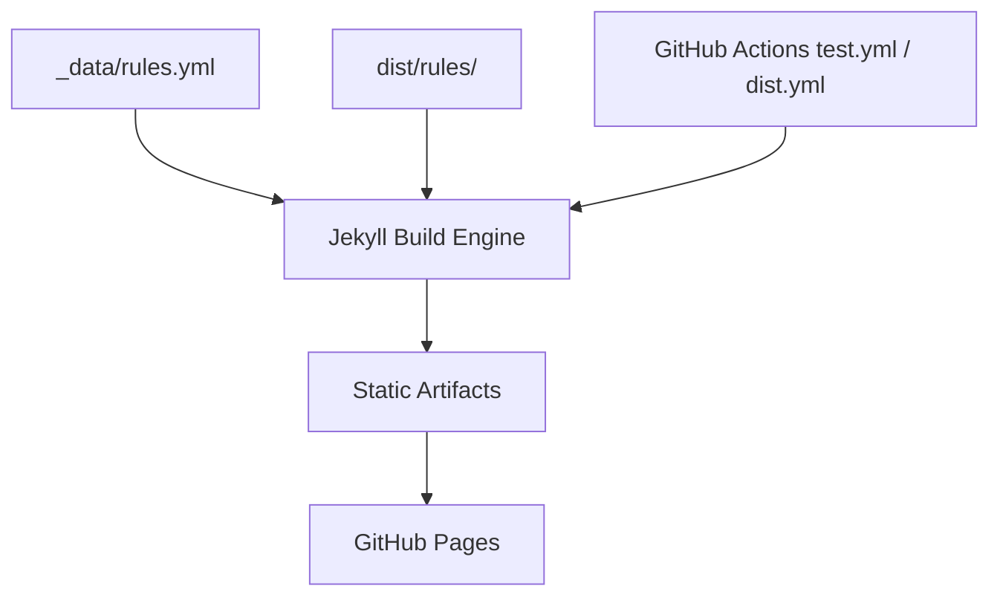

# samber/awesome-prometheus-alerts

> Collection de règles d'alerte Prometheus en YAML à copier, pour plus de 90 services.

## Le problème
Écrire de zéro les règles d'alerte Prometheus pour chaque base, broker ou orchestrateur est long et sujet à oubli.

## Ce que ça fait vraiment
Un catalogue de plus de 1 155 règles pour 93 services (hôte, MySQL, PostgreSQL, Redis, Kafka, Kubernetes, Spark, Flink, LiteLLM, etc.), publié en site statique Jekyll sur GitHub Pages. Tu copies le YAML voulu dans ta config.

## Comment c'est branché

## Essayer
Aucune commande documentée dans le README. Le catalogue se consulte sur https://samber.github.io/awesome-prometheus-alerts.

## Coût et pièges
Gratuit. Les règles sont des points de départ : seuils et labels sont à adapter à ton environnement, sinon bruit d'alertes. Le README mentionne des sponsors.

## Ce que ce n'est pas
Pas un outil installable ni un exportateur de métriques : il faut déjà Prometheus et les exporters. Licence présente mais non identifiée par GitHub.

## Alternatives
Aucune alternative nommée dans le README.

## Pour toi
À adopter en référence : pour de l'observabilité MLOps (Kubernetes, Kafka, Spark, LiteLLM), c'est un gain de temps immédiat, à relire avant de déployer.

