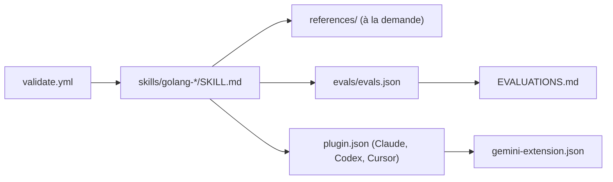

# samber/cc-skills-golang

> Go skills pack for coding agents (Claude Code, Codex, Gemini, Cursor…), loaded on demand.

## The problem
A coding agent writes passable Go but ignores conventions (errors, naming, tests, security) and common libraries. Without rules, you fix the same flaws every session.

## What it actually does
About 50 `skills/golang-*` folders, each with a `SKILL.md` (trigger + instructions) and `references/` loaded only when needed. Covers style, tests, security, observability, DI (wire, dig, fx) and the samber/* libraries. Plugin manifests expose the pack to Claude, Codex, Cursor and Gemini. The README shows an evaluation: 3348/3439 with the skill versus 1957/3439 without (author's measurement, unverified).

## How it is wired


## Trying it
```bash
npx skills add https://github.com/samber/cc-skills-golang --all
# ou une seule skill :
npx skills add https://github.com/samber/cc-skills-golang --skill golang-performance
/plugin marketplace add samber/cc
/plugin install cc-skills-golang@samber
```

## Cost and gotchas
Free, no key. The README says installing a subset gives an inconsistent view: the skills refer to one another. Descriptions stay loaded permanently (~1,100 tokens for the recommended skills).

## What it is not
Not a Go tool: it is documentation for agents. Does not cover the git/CI/PR workflow (refers to another pack). The announced gains come from the author's evals.

## Alternatives
The README points to `cc-skills` (samber) for non-Go skills.

## For you
Ignore: the Go stack is outside your data/AI/MLOps profile; keep only the idea of a skills pack evaluated with/without, reusable for Python.
