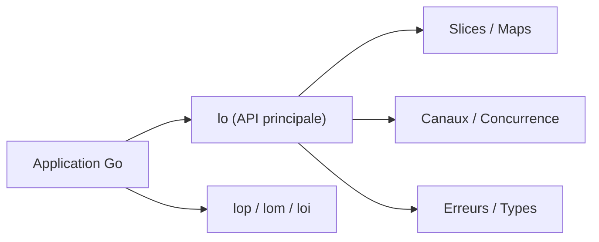

# samber/lo

> Lodash-style Go library, built on generics, for manipulating slices, maps and channels.

## The problem
Filtering, mapping and grouping loops in Go are verbose, especially since generics arrived.

## What it actually does
Dozens of typed helpers: `Filter`, `Map`, `Reduce`, `GroupBy`, `Chunk`, `Uniq` for slices; keys and values for maps; math and strings; tuples; channels (`FanIn`, `FanOut`, `Buffer`); search, conditions, error handling (`Must`, `Try`); concurrency (`Debounce`, `Throttle`, `Attempt`). Sub-packages `parallel`, `mutable`, `it`. No dependency outside the standard library, strict semver in v1.

## How it is wired


## Trying it
```bash
go get github.com/samber/lo@v1
npx skills add https://github.com/samber/cc-skills-golang --skill golang-samber-lo
```

## Cost and gotchas
Free. Go 1.18 or later. The README notes that `lo.Map` is about 4% slower than a `for` loop and that `lop.Map` allocates more: reserve it for long-running processing.

## What it is not
Not infinite stream processing: the README points to `samber/ro` for that. A few helpers overlap with the standard library's `slices` and `maps`.

## Alternatives
`samber/ro` for event streams, `samber/do` for dependency injection, `samber/mo` for monads (all named in the README).

## For you
Ignore, unless your pipeline or MLOps tooling is in Go: nothing here touches Python or models.
