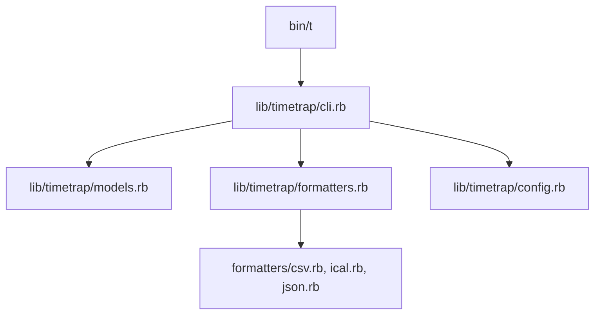

# samg/timetrap

> Command-line time tracking, written in Ruby, for developers who live in the terminal.

## The problem
Know how much time you spend on each task without opening a graphical application or creating an account.

## What it actually does
The t command manages timesheets and entries with a note: in, out, edit, display, now, resume, archive. Times are entered in natural language ("5 minutes ago"). Output in text, CSV, iCal, JSON, with custom formatters and automatic sheets. Data is stored in SQLite.

## How it is wired


## Trying it
```bash
gem install timetrap
t sheet coding
t in document timetrap
t now
t out
t display --format csv
```

## Cost and gotchas
Free. Requires Ruby. Last push in March 2025 and license not identified by GitHub: to be checked.

## What it is not
Not a team or billing tool: no server, exports to Harvest or Toggl go through third-party plugins.

## Alternatives
The community formatters timetrap_formatters, timetrap-harvest and timetrap-toggl extend the tool, they do not replace it.

## For you
Ignore: Ruby tool unrelated to your work and not very active; a CSV export of the hours remains the only appeal.
