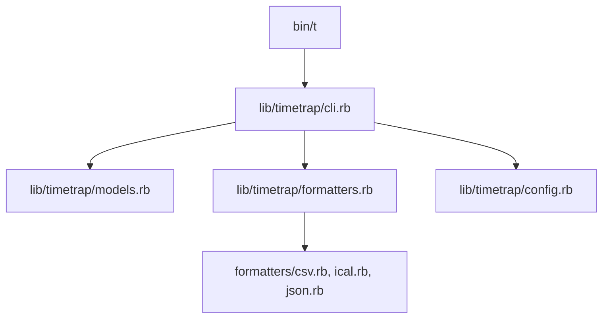

# samg/timetrap

> Suivi du temps en ligne de commande, écrit en Ruby, pour développeurs qui vivent dans le terminal.

## Le problème
Savoir combien de temps tu passes sur chaque tâche sans ouvrir une application graphique ni créer de compte.

## Ce que ça fait vraiment
La commande t gère des feuilles de temps et des entrées avec note : in, out, edit, display, now, resume, archive. Les heures se saisissent en langage naturel ("5 minutes ago"). Sorties en texte, CSV, iCal, JSON, avec formateurs et feuilles automatiques personnalisables. Les données sont dans SQLite.

## Comment c'est branché


## Essayer
```bash
gem install timetrap
t sheet coding
t in document timetrap
t now
t out
t display --format csv
```

## Coût et pièges
Gratuit. Nécessite Ruby. Dernier push en mars 2025 et licence non identifiée par GitHub : à vérifier.

## Ce que ce n'est pas
Pas un outil d'équipe ni de facturation : pas de serveur, des exports vers Harvest ou Toggl par des greffons tiers.

## Alternatives
Les formateurs communautaires timetrap_formatters, timetrap-harvest et timetrap-toggl étendent l'outil, ils ne le remplacent pas.

## Pour toi
Ignorer : outil Ruby sans lien avec ton métier et peu actif ; un export CSV des heures reste le seul intérêt.

