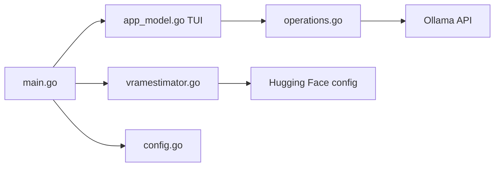

# sammcj/gollama

> Terminal interface to list, sort, edit and delete Ollama models, with vRAM estimation.

## The problem
Cleaning up and inspecting many Ollama models on the command line is tedious.

## What it actually does
Go TUI: list with size, quantization and family, sorting, inspection, copying, deletion, Modelfile editing, running and unloading models, pushing to a registry, a view of running models. A vRAM estimator computes memory, maximum context and best quantization for an Ollama or Hugging Face model. Themes and JSON config.

## How it is wired


## Trying it
```bash
go install github.com/sammcj/gollama/v2@latest
gollama
gollama --vram llama3.1:8b-instruct-q6_K
```

## Cost and gotchas
Free, Ollama required. The author announces a slowdown in maintenance (December 2025) and the dropping of the LM Studio link since v2.0.1; he barely uses Ollama anymore.

## What it is not
Not a model server. CUDA vRAM detection is marked "coming soon".

## Alternatives
No alternative named in the README (the author cites llama.cpp with llama-swap and LM Studio for serving models).

## For you
Worth watching: useful if you accumulate Ollama models, and the vRAM estimator stands out, but the author is slowing the project down.
