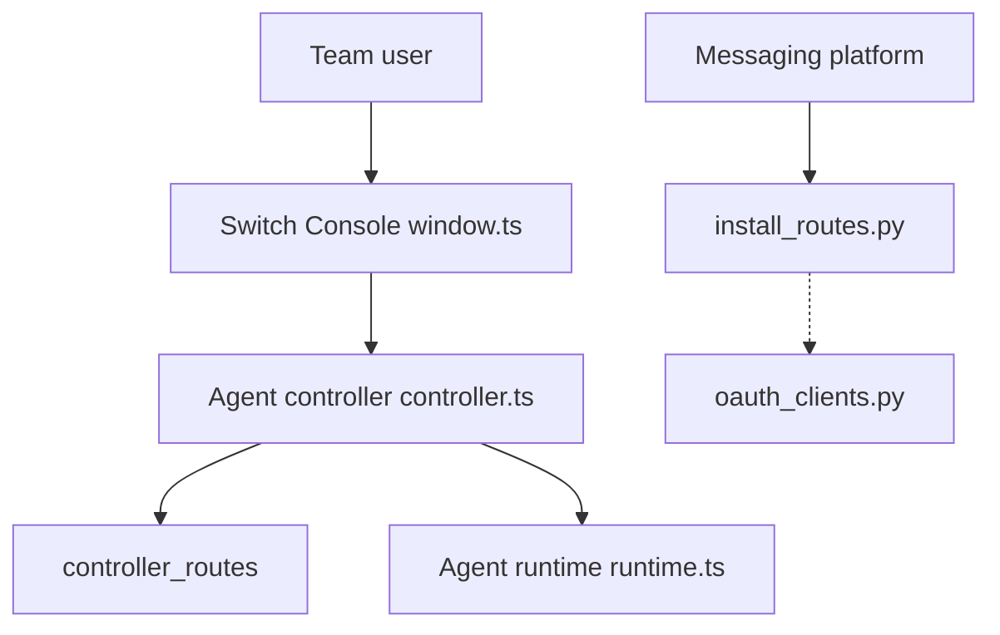

# sandbox-quantum/switch

> Self-hosted platform that makes AI agents and humans work together in Slack, Teams, Discord, Telegram, Mattermost.

## The problem
Agents (Claude Code, Codex) stay isolated on each person's machine. Context gets lost between colleagues and agents.

## What it actually does
Each channel becomes a room shared by people and agents. Each agent gets a role, instructions, tools (Google Workspace, Jira, GitHub) and only sees its own rooms. Switch provides neither an agent nor a model. The server (Switch Core, Python) handles OAuth and the bridges to messaging platforms; the desktop app (Switch Console) drives agents and server. Guardrails and cost tracking fall under Switch Trust and Switch ROI, not detailed.

## How it is wired


## Trying it
```bash
claude mcp add switch-docs --transport http https://docs.switchagents.ai/mcp
codex mcp add switch-docs --url https://docs.switchagents.ai/mcp
```
Installation: download Switch Console (macOS, Windows, Linux) from the latest release, then talk to switch-buddy.

## Cost and gotchas
Agents and models remain at your expense. Console telemetry is enabled by default (opt-out); server telemetry is off by default. 559 open issues. License present but not identified.

## What it is not
Not a messaging app, not an agent provider, not a turnkey platform. The README describes four levels of use, the most advanced of which are vision.

## Alternatives
None named in the README.

## For you
Worth watching: relevant for a team already running several agents, but the unclear license and 559 open issues suggest waiting.
