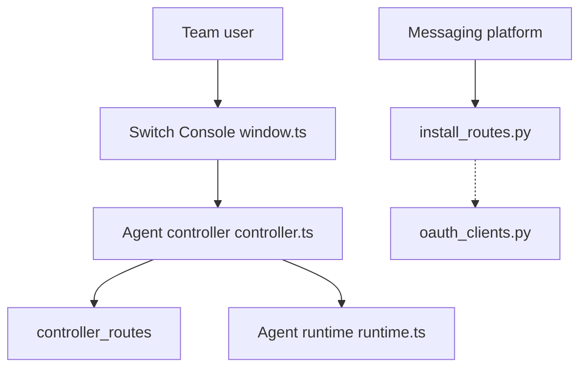

# sandbox-quantum/switch

> Plateforme auto-hébergée qui fait travailler agents IA et humains ensemble dans Slack, Teams, Discord, Telegram, Mattermost.

## Le problème
Les agents (Claude Code, Codex) restent isolés sur la machine de chacun. Le contexte se perd entre collègues et agents.

## Ce que ça fait vraiment
Chaque canal devient une salle partagée par personnes et agents. Chaque agent reçoit un rôle, des instructions, des outils (Google Workspace, Jira, GitHub) et ne voit que ses salles. Switch ne fournit ni agent ni modèle. Le serveur (Switch Core, Python) gère OAuth et les ponts vers les messageries ; l'app de bureau (Switch Console) pilote agents et serveur. Garde-fous et suivi des coûts relèvent de Switch Trust et Switch ROI, non détaillés.

## Comment c'est branché


## Essayer
```bash
claude mcp add switch-docs --transport http https://docs.switchagents.ai/mcp
codex mcp add switch-docs --url https://docs.switchagents.ai/mcp
```
Installation : télécharger Switch Console (macOS, Windows, Linux) depuis la dernière release, puis parler à switch-buddy.

## Coût et pièges
Les agents et modèles restent à ta charge. Télémétrie du Console activée par défaut (opt-out) ; celle du serveur est coupée par défaut. 559 issues ouvertes. Licence présente mais non identifiée.

## Ce que ce n'est pas
Pas une messagerie, pas un fournisseur d'agents, pas une plateforme clé en main. Le README décrit quatre niveaux d'usage, les plus avancés relèvent de la vision.

## Alternatives
Aucune nommée dans le README.

## Pour toi
À surveiller : pertinent pour une équipe qui exploite déjà plusieurs agents, mais licence floue et 559 issues ouvertes invitent à attendre.

