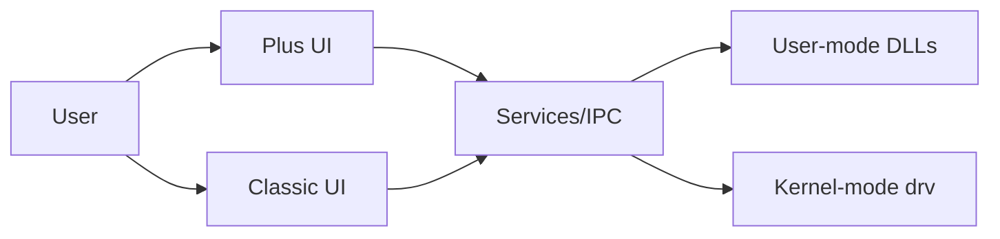

# sandboxie-plus/Sandboxie

> Isolation sandbox for Windows to run untrusted programs without modifying the system.

## The problem
Testing a dubious program or browsing without leaving traces on the disks and the registry.

## What it actually does
Creates isolated "boxes": user-mode DLLs (hooks), kernel driver, services and IPC. Plus edition (Qt interface) with snapshots, per-box firewall, privacy mode, AES-encrypted boxes, memory quotas, forced SOCKS5 proxy; Classic edition with the old MFC interface. Windows 7 or later, 64-bit.

## How it is wired

## Trying it
No command in the README: download the latest published release.

## Cost and gotchas
Free. It is a community fork (David Xanatos), not the official suite, the README states. Windows only.

## What it is not
Not a virtual machine; does not replace an antivirus.

## Alternatives
None named in the README.

## For you
Ignore: program isolation on Windows, unrelated to your data / AI work on Linux.
