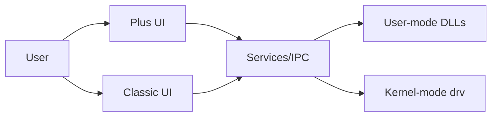

# sandboxie-plus/Sandboxie

> Bac à sable d'isolation pour Windows afin d'exécuter des programmes non fiables sans modifier le système.

## Le problème
Tester un programme douteux ou naviguer sans laisser de traces sur les disques et le registre.

## Ce que ça fait vraiment
Crée des « boîtes » isolées : DLL en mode utilisateur (hooks), pilote noyau, services et IPC. Édition Plus (interface Qt) avec instantanés, pare-feu par boîte, mode confidentialité, boîtes chiffrées AES, quotas mémoire, proxy SOCKS5 forcé ; édition Classic à l'interface MFC ancienne. Windows 7 ou plus, 64 bits.

## Comment c'est branché

## Essayer
Aucune commande dans le README : téléchargement de la dernière version publiée.

## Coût et pièges
Gratuit. Il s'agit d'un fork communautaire (David Xanatos), pas de la suite officielle, précise le README. Réservé à Windows.

## Ce que ce n'est pas
Pas une machine virtuelle ; ne remplace pas un antivirus.

## Alternatives
Aucune nommée dans le README.

## Pour toi
Ignorer : isolation de programmes sous Windows, sans lien avec ton travail data / IA sous Linux.

