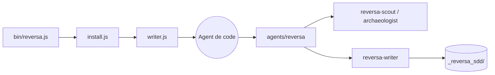

# sandeco/reversa

> Agent framework that extracts, from legacy code, specifications usable by other coding agents.

## The problem
A legacy system carries implicit business rules and decisions that were never written down; without a spec, a coding agent does not know what it must not break.

## What it actually does
`npx reversa install` detects the agents present (Claude Code, Codex, Cursor...), copies skills into `.agents/skills/` and creates `.reversa/` (state, config, plan, SHA-256 manifest).
`/reversa` chains Scout (surface), Archaeologist (modules), Detective (rules, retroactive ADRs), Architect (C4, ERD), Writer, then Reviewer; a `CONTINUAR` pause between agents, resume via `.reversa/state.json`.
Output goes to `_reversa_sdd/`: inventory, data dictionary, state machines, per-component specs, traceability matrices.
Other teams: evolution (`/reversa-forward`), migration, HTML mini-site, bugs, refactor, estimation.

## How it is wired


## Trying it
```bash
npx reversa install
# puis, dans l'agent :
# /reversa
```

## Cost and gotchas
Reversa asks for no key: everything goes through the agent already installed, hence through its subscription or key. The cost of a full analysis is not quantified in the README. Node.js 18+.

## What it is not
Not risk-free: the installer does not modify your files and the agents' writes are restricted by instruction to `.reversa/` and `_reversa_sdd/`, but the README requires a commit and a backup, since an agent can be wrong.
Not documentation for humans: these are contracts meant for agents.
Commands and artifacts are partly in Portuguese (`CONTINUAR`, `expresso`).

## Alternatives
No alternative named in the README.

## For you
Useful for documenting old code before handing it to an agent; test first on a small module.
