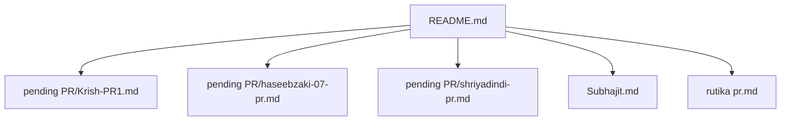

# sanjay-kv/Open-source-Practice

> Practice repository where beginners make their first pull request by adding their name to a list.

## The problem
A beginner does not know how to fork, branch and open a PR. They need a risk-free place to practice.

## What it actually does
The README guides step by step, in the browser or locally, to adding your name to an alphabetical list. It also covers resolving merge conflicts. No code: contributions are markdown files in `pending PR`.

## How it is wired
Diagram based on the code diagram.


## Trying it
```bash
git clone https://github.com/GSSoC24/being-an-GSSoc24.git
cd being-an-GSSoc24
git checkout -b <name-of-new-branch>
git add README.md
git commit -m "Add <your-github-username>"
git push origin <name-of-new-branch>
```

## Cost and gotchas
Free. The README targets the GSSoC 2024 edition: the links and commands point to that edition's repository.

## What it is not
Not a tool or a technical resource: the README is mostly a long list of names. No value for a real project.

## Alternatives
No alternative named in the README.

## For you
Ignore: you already master the fork / PR flow; this repository only serves complete beginners.
