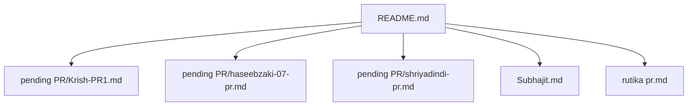

# sanjay-kv/Open-source-Practice

> Dépôt d'entraînement où des débutants font leur première pull request en ajoutant leur nom à une liste.

## Le problème
Un débutant ne sait pas forker, brancher et ouvrir une PR. Il faut un terrain sans risque pour s'exercer.

## Ce que ça fait vraiment
Le README guide pas à pas, dans le navigateur ou en local, vers l'ajout de son nom dans une liste alphabétique. Il couvre aussi la résolution de conflits de fusion. Pas de code : les contributions sont des fichiers markdown dans `pending PR`.

## Comment c'est branché
Schéma d'après le diagramme du code.


## Essayer
```bash
git clone https://github.com/GSSoC24/being-an-GSSoc24.git
cd being-an-GSSoc24
git checkout -b <name-of-new-branch>
git add README.md
git commit -m "Add <your-github-username>"
git push origin <name-of-new-branch>
```

## Coût et pièges
Gratuit. Le README cible l'édition GSSoC 2024 : les liens et commandes renvoient au dépôt de cette édition.

## Ce que ce n'est pas
Pas un outil ni une ressource technique : le README est surtout une longue liste de noms. Aucune valeur pour un projet réel.

## Alternatives
Aucune alternative nommée dans le README.

## Pour toi
À ignorer : tu maîtrises déjà le flux fork / PR, ce dépôt ne sert qu'aux tout débutants.

