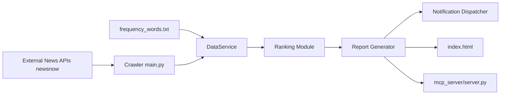

# sansan0/TrendRadar

> Chinese trending-topics aggregator filtered by keywords, with notifications and an analysis MCP server.

## The problem
Following the news across a dozen Chinese platforms drowns the user in topics unrelated to what interests them.

## What it actually does
According to the provided architecture (generic but citing files): `main.py` fetches hot topics via the newsnow project's API, filters according to `frequency_words.txt` (required words, exclusions), ranks by weight (rank, frequency, popularity), generates HTML/text reports in `output/` and notifies (WeChat, Feishu, DingTalk, Telegram, e-mail, ntfy).
Three delivery modes: daily, current, incremental. An MCP server (`mcp_server/server.py`) exposes analysis tools (trends, sentiment, cross-platform comparison) to AI clients. Runs via GitHub Actions after a fork, or Docker.

## How it is wired

## Trying it
No command in the part of the README that was read, which is taken up by acknowledgments and donations.

## Cost and gotchas
Free, GPL-3.0. All data comes from the newsnow API, offered out of its author's goodwill: the README asks to limit the request frequency.

## What it is not
Not a generic monitoring tool: the sources are Chinese platforms. The part of the README that was read does not document the tool itself.

## Alternatives
No alternative named in the README (newsnow is the data source, not a competitor).

## For you
Ignore: sources out of scope; only the trend-analysis MCP server deserves a look.
