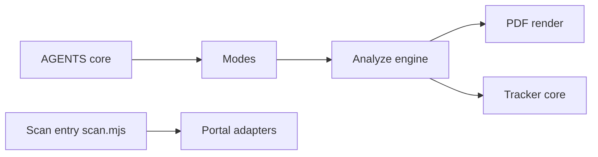

# santifer/career-ops

> Job search pipeline managed by a command-line interface (CLI) for an agent: evaluates job postings, adapts the resume, and tracks applications.

## The problem
Tracking dozens of job postings, tailoring your resume to each one, and maintaining a record of your applications is a time-consuming and disorganized process.

## What it actually does
The agent uses Markdown templates to evaluate a job offer on a grid (A-H), generates CVs and cover letters in PDF format (using Playwright), scans job boards, and maintains local records. A Go-based dashboard, with batch processing capabilities. It never applies for jobs on your behalf.

## How it is wired


## Trying it
```bash
npx @santifer/career-ops init
cd career-ops
claude
npm run doctor
```

## Cost and gotchas
Consume tokens; a `ANTHROPIC_API_KEY` in the environment must be set before subscribing. Your CV will be sent to the chosen provider.

## What it is not
This is not an automated application tool. The evaluations are recommendations, and the AI can invent skills. The license is not declared in the catalog (the README states MIT).

## Alternatives
No alternative is specified in the README file.

## For you
This is not relevant for data/MLOps use: it's a personal job search tool, and has no connection to your technical work.
