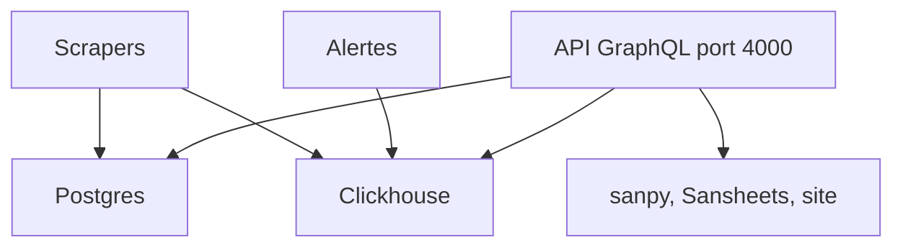

# santiment/sanbase2

> Code of Santiment's GraphQL API server, market and social data on cryptocurrencies.

## The problem
Serving crypto metrics, alerts and user data through a single access point, limited by subscription.

## What it actually does
Elixir server in three parts: price and social data scrapers, alerts on time series, a GraphQL API with authentication and plan-based limits. It powers the website, the public API, the Google Sheets plugin and the Python client sanpy.

## How it is wired
Simplified diagram based on the sheet, no diagram provided.



## Trying it
```bash
bin/server.sh
bin/setup.sh
bin/console.sh
./bin/test.sh
```

## Cost and gotchas
Postgres and Clickhouse are mandatory, with data that the repository does not provide. Elixir 1.10 and OTP 22, which are old.

## What it is not
Cannot run on its own: the author says the project does not run without its databases.

## Alternatives
- sanpy: Python client of the API, mentioned in the README.

## For you
Ignore: Elixir reference code, unusable without Santiment's data.
