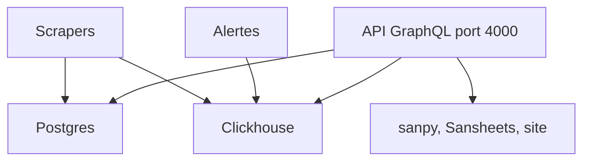

# santiment/sanbase2

> Code du serveur d'API GraphQL de Santiment, données de marché et sociales sur les cryptomonnaies.

## Le problème
Servir des métriques crypto, des alertes et des données utilisateurs à travers un point d'accès unique et limité par abonnement.

## Ce que ça fait vraiment
Serveur Elixir en trois parties : scrapers de prix et de données sociales, alertes sur séries temporelles, API GraphQL avec authentification et limitation par offre. Il alimente le site, l'API publique, le plugin Google Sheets et le client Python sanpy.

## Comment c'est branché
Schéma simplifié d'après la fiche, sans diagramme fourni.



## Essayer
```bash
bin/server.sh
bin/setup.sh
bin/console.sh
./bin/test.sh
```

## Coût et pièges
Postgres et Clickhouse obligatoires, avec des données que le dépôt ne fournit pas. Elixir 1.10 et OTP 22, anciens.

## Ce que ce n'est pas
Pas exécutable seul : l'auteur dit que le projet ne tourne pas sans ses bases de données.

## Alternatives
- sanpy : client Python de l'API, cité dans le README.

## Pour toi
Ignorer : un code de référence Elixir, inexploitable sans les données de Santiment.

