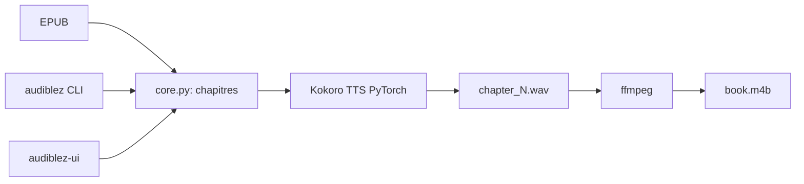

# santinic/audiblez

> Converts an EPUB book into an M4B audiobook with local speech synthesis, from the command line or a GUI.

## The problem
Listening to an ebook means finding or paying for an audiobook, or producing one yourself chapter by chapter.

## What it actually does
Reads the EPUB, identifies the chapters (interactive selection with `--pick`), generates one WAV file per chapter with a Kokoro-82M TTS model, then merges everything into an `.m4b` with ffmpeg. Voice choice, speed from 0.5 to 2.0 and the `--cuda` option are available. A wxPython interface exists (`audiblez-ui`). According to the architecture described from the code, CLI and GUI share `core.py`.

## How it is wired


## Trying it
```bash
sudo apt install ffmpeg espeak-ng
pip install audiblez
audiblez book.epub -v af_sky
audiblez book.epub -v af_sky -s 1.5
audiblez-ui
```

## Cost and gotchas
Free. `espeak-ng` and `ffmpeg` are required, otherwise the `.m4b` is not produced. No Apple Silicon support for now. On Windows, the README recommends a venv.

## What it is not
It is not a cloned voice nor an online service: everything runs locally, but the output depends on the quality of Kokoro.

## Alternatives
No alternative named in the README.

## For you
Keep an eye on it: a concrete example of local TTS to try if you want audiobooks, but a narrow tool, maintained by a single person and without Apple Silicon support.
