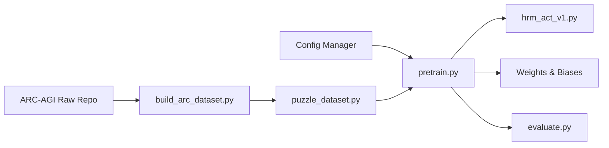

# sapientinc/HRM

> Research code for the Hierarchical Reasoning Model, a small recurrent network for reasoning puzzles.

## The problem
LLMs reason through chain of thought, which is costly in data and latency, and they struggle on hard Sudoku, mazes or ARC.

## What it actually does
Implements HRM (27 M parameters): a slow high-level planning module and a fast low-level module, in a single pass.
Dataset-building scripts (ARC-1/2, Sudoku, Maze), `pretrain.py` training, `evaluate.py` evaluation and the `arc_eval.ipynb` notebook.
Checkpoints provided for ARC-AGI-2, Sudoku and Maze; an HTML puzzle visualizer.
Experiment tracking on Weights & Biases is mandatory.

## How it is wired


## Trying it
```bash
pip install -r requirements.txt
wandb login
python dataset/build_sudoku_dataset.py --output-dir data/sudoku-extreme-1k-aug-1000  --subsample-size 1000 --num-aug 1000
OMP_NUM_THREADS=8 python pretrain.py data_path=data/sudoku-extreme-1k-aug-1000 epochs=20000 eval_interval=2000 global_batch_size=384 lr=7e-5 puzzle_emb_lr=7e-5 weight_decay=1.0 puzzle_emb_weight_decay=1.0
```

## Cost and gotchas
A CUDA GPU is required, CUDA extensions and FlashAttention must be compiled; ~10 h on a laptop RTX 4070 for the demo.
Full experiments on 8 GPUs; a W&B account is required.

## What it is not
Not an LLM nor a general-purpose model: it is trained per puzzle task.
A variance of ±2 points and late-training instability are reported.

## Alternatives
No alternative named in the README.

## For you
Worth watching for research monitoring on compact reasoning; nothing to plug into a data/MLOps pipeline today.
