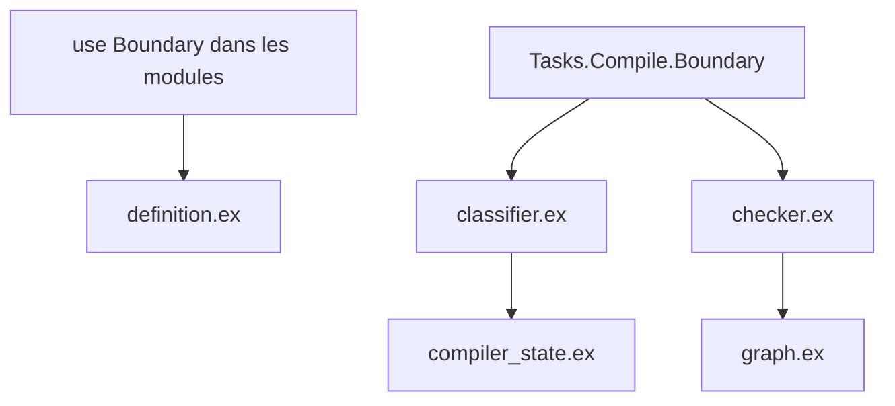

# sasa1977/boundary

> Mix compiler that forbids calls between Elixir modules that are not allowed by declared boundaries.

## The problem
In an Elixir project, nothing prevents the web layer from calling the context's internal modules, or the reverse.

## What it actually does
You declare boundaries with `use Boundary, deps: [...], exports: [...]`. The `:boundary` compiler reports forbidden calls at compile time, including calls to external applications such as Phoenix, Ecto or Mix. It plugs into editors that support mix compilers.

## How it is wired


## Trying it
```bash
# mix.exs : {:boundary, "~> 0.12", runtime: false}
# puis : compilers: [:boundary] ++ Mix.compilers()
mix compile
```

## Cost and gotchas
Free. The README says it has been used in production on small projects, with no testing on large projects or umbrella apps.

## What it is not
Neither a style linter nor a runtime tool: it only checks at compile time.

## Alternatives
No alternative named in the README.

## For you
Ignore: only useful if you write Elixir.
