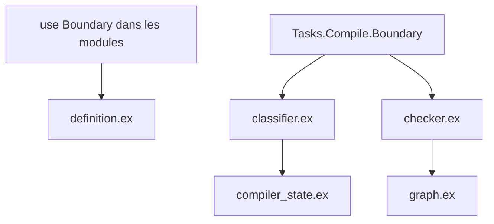

# sasa1977/boundary

> Compilateur mix qui interdit les appels entre modules Elixir non autorisés par des frontières déclarées.

## Le problème
Dans un projet Elixir, rien n'empêche la couche web d'appeler les modules internes du contexte ou l'inverse.

## Ce que ça fait vraiment
On déclare des frontières avec `use Boundary, deps: [...], exports: [...]`. Le compilateur `:boundary` signale à la compilation les appels interdits, y compris vers des applications externes comme Phoenix, Ecto ou Mix. Il se branche sur les éditeurs compatibles avec les compilateurs mix.

## Comment c'est branché


## Essayer
```bash
# mix.exs : {:boundary, "~> 0.12", runtime: false}
# puis : compilers: [:boundary] ++ Mix.compilers()
mix compile
```

## Coût et pièges
Gratuit. Le README dit l'avoir utilisé en production sur de petits projets, sans test sur de gros projets ou umbrella.

## Ce que ce n'est pas
Ni un linter de style ni un outil d'exécution : il vérifie seulement à la compilation.

## Alternatives
Aucune alternative nommée dans le README.

## Pour toi
Ignorer : utile seulement si tu écris de l'Elixir.

