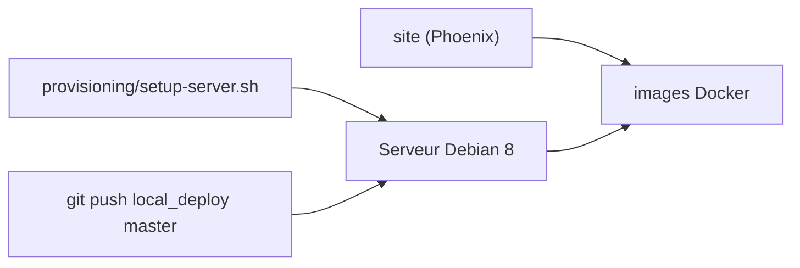

# sasa1977/erlangelist

> Complete source code of The Erlangelist site: site, articles, Docker images and server setup.

## The problem
See how an author self-deploys a complete Phoenix site with Docker, Ansible and git-push deployment.

## What it actually does
Contains the site (Elixir/Phoenix), the articles, the Docker images and the provisioning scripts. Deployment is done by pushing to a git repository on the server, which builds the images. Target: Debian 8. Last push in February 2024.

## How it is wired
Simplified diagram based on the sheet, no diagram provided.


## Trying it
```bash
cd site
mix deps.get
pushd assets && npm install && popd
iex -S mix phx.server
```

## Cost and gotchas
Erlang, Elixir and Node.js (versions in `.tool-versions`). The setup script modifies the system (user, iptables): do not run it on an important machine.

## What it is not
Not a reusable tool: it is an author's site. The Debian 8 target is obsolete, the license is unidentified by GitHub.

## Alternatives
No alternative named in the README.

## For you
Ignore: a dated deployment example, unrelated to data, AI or MLOps.
