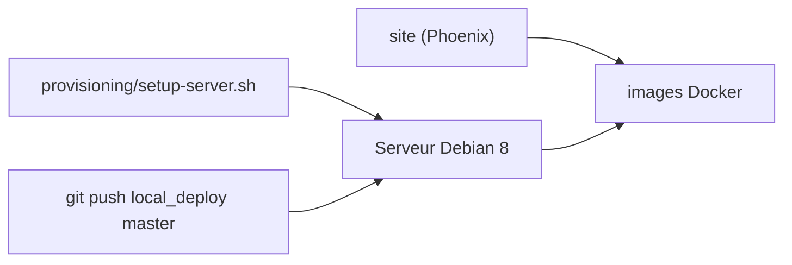

# sasa1977/erlangelist

> Code source complet du site The Erlangelist : site, articles, images Docker et installation serveur.

## Le problème
Voir comment un auteur déploie lui-même un site Phoenix complet avec Docker, Ansible et déploiement par git push.

## Ce que ça fait vraiment
Contient le site (Elixir/Phoenix), les articles, les images Docker et les scripts de provisionnement. Le déploiement se fait en poussant sur un dépôt git du serveur, qui construit les images. Cible : Debian 8. Dernier push en février 2024.

## Comment c'est branché
Schéma simplifié d'après la fiche, sans diagramme fourni.


## Essayer
```bash
cd site
mix deps.get
pushd assets && npm install && popd
iex -S mix phx.server
```

## Coût et pièges
Erlang, Elixir et Node.js (versions dans `.tool-versions`). Le script d'installation modifie le système (utilisateur, iptables) : ne pas l'exécuter sur une machine importante.

## Ce que ce n'est pas
Ce n'est pas un outil réutilisable : c'est le site d'un auteur. La cible Debian 8 est obsolète, la licence est non identifiée par GitHub.

## Alternatives
Aucune alternative nommée dans le README.

## Pour toi
À ignorer : exemple de déploiement daté, sans lien avec data, IA ou MLOps.

