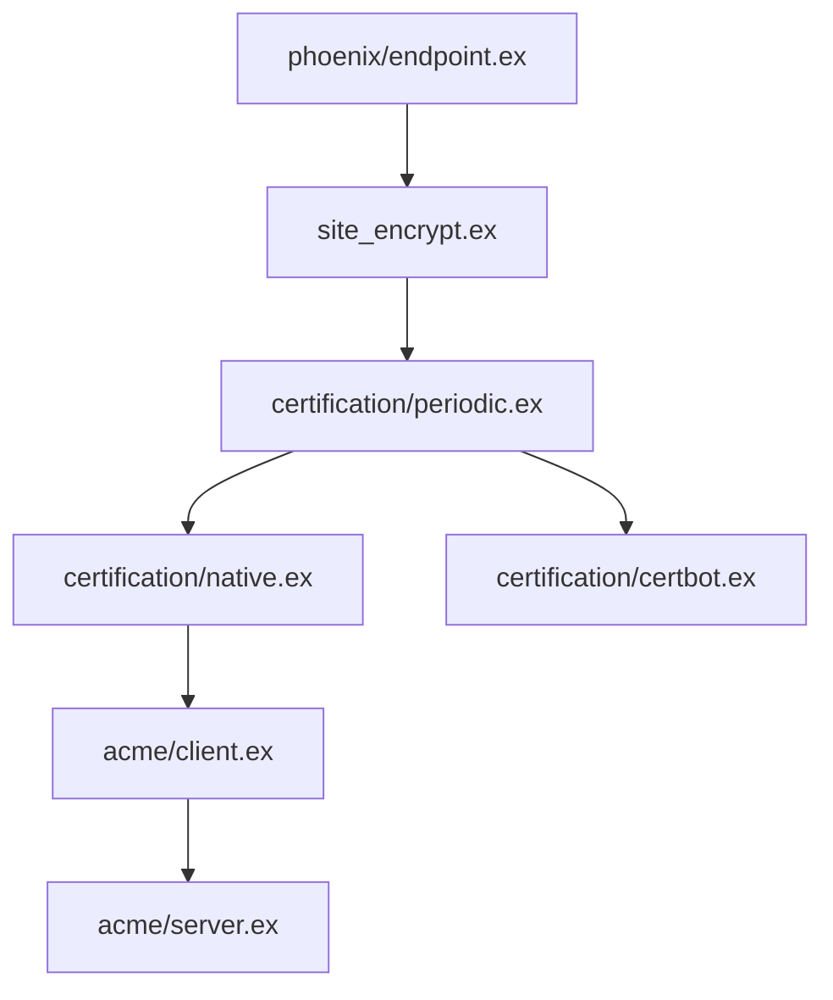

# sasa1977/site_encrypt

> Automatically obtains and renews Let's Encrypt certificates for an Elixir site, with no external process.

## The problem
A small Elixir site without a reverse proxy has to manage its own HTTPS certificates and their renewal.

## What it actually does
A Phoenix endpoint relies on `site_encrypt.ex` to launch periodic certification, through the native ACME client or through Certbot; a local ACME server is used for tests. Certificates are stored in a folder that must be set outside the deployment folder.

## How it is wired


## Trying it
```bash
# mix.exs : ajouter {:site_encrypt, "~> 0.7"}, puis
mix deps.get
iex -S mix phx.server
```

## Cost and gotchas
Free. Port 80 must be reachable from the Internet for Let's Encrypt, and its rate limits apply. The native client is young; Certbot (>= 0.31) is more stable but must be installed. The API is not stable.

## What it is not
Not a tool for other languages or for sites behind a proxy.

## Alternatives
Certbot, usable as the client instead of the native client.

## For you
Ignore: useful only to those running an Elixir/Phoenix site; outside the data/AI/MLOps scope.
