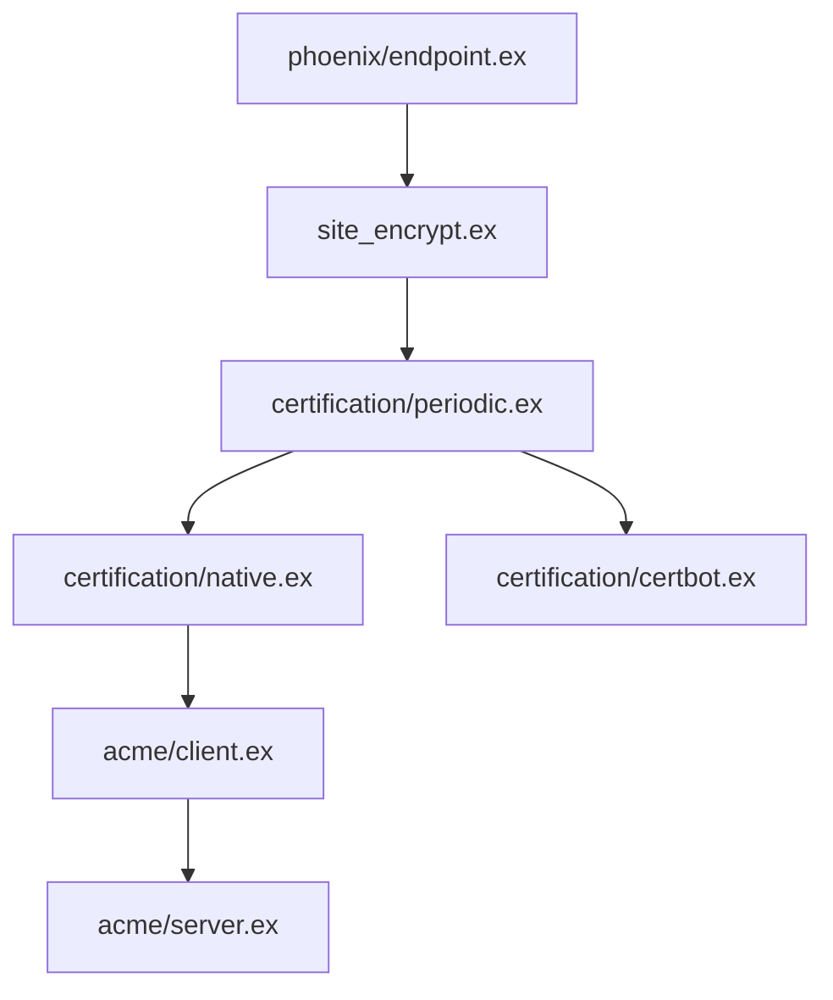

# sasa1977/site_encrypt

> Obtient et renouvelle automatiquement les certificats Let's Encrypt d'un site Elixir, sans processus externe.

## Le problème
Un petit site Elixir sans proxy inverse doit gérer lui-même ses certificats HTTPS et leur renouvellement.

## Ce que ça fait vraiment
Un endpoint Phoenix s'appuie sur `site_encrypt.ex` pour lancer une certification périodique, par le client ACME natif ou par Certbot ; un serveur ACME local sert aux tests. Les certificats sont stockés dans un dossier à fixer hors du dossier de déploiement.

## Comment c'est branché


## Essayer
```bash
# mix.exs : ajouter {:site_encrypt, "~> 0.7"}, puis
mix deps.get
iex -S mix phx.server
```

## Coût et pièges
Gratuit. Le port 80 doit être joignable depuis Internet pour Let's Encrypt, et ses limites de débit s'appliquent. Le client natif est jeune ; Certbot (>= 0.31) est plus stable mais doit être installé. L'API n'est pas stable.

## Ce que ce n'est pas
Pas un outil pour d'autres langages ni pour des sites derrière un proxy.

## Alternatives
Certbot, utilisable comme client à la place du client natif.

## Pour toi
À ignorer : utile seulement à qui exploite un site Elixir/Phoenix ; hors périmètre data/IA/MLOps.

