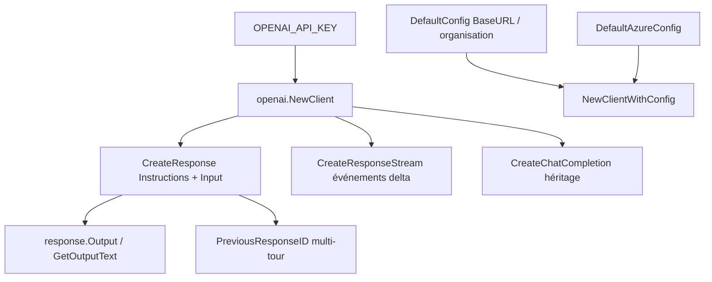

# sashabaranov/go-openai

> Unofficial Go client for the OpenAI API, centred on the Responses API.

## The problem
Calling the OpenAI API from Go otherwise means building requests, types and streaming handling yourself.
The shift from Chat Completions to Responses changes the shape of the exchanges, so home-grown code goes stale.

## What it actually does
Covers the Responses API (`CreateResponse`, `CreateResponseStream`, `GetOutputText`, `PreviousResponseID` for multi-turn state) and keeps Chat Completions for existing code.
Also covers embeddings, images, audio, moderation, files, fine-tuning, batches, vector stores and the legacy Assistants surfaces.
Model constants per tier — `GPT5Dot6Sol`, `GPT5Dot6Terra`, `GPT5Dot6Luna`, alias `GPT5Dot6` — and acceptance of string identifiers for models not yet given a constant.
Configuration through `DefaultConfig` (HTTP client, `BaseURL`, organisation, headers) or `DefaultAzureConfig` for Azure OpenAI; errors can be inspected with `errors.As` on `*openai.APIError`.

## How it is wired


## Trying it
```sh
go get github.com/sashabaranov/go-openai
export OPENAI_API_KEY="<your key>"
go run ./examples/responses
```

## Cost and gotchas
The library is free; every call is billed by OpenAI, on your key.
Cost trap flagged by the README: do not use the top-tier model for everything, pick the Sol/Terra/Luna tier according to the workload. You must resend `Instructions` on every call for them to keep applying, and `Store` must be set to chain through `PreviousResponseID`.

## What it is not
Not official: the README announces it as an unofficial client.
Not an agent framework: no tool loop is provided, only API calls.
Not limited to OpenAI in practice, since `BaseURL` accepts a compatible endpoint — with no compatibility guarantee.

## Alternatives
No alternative named in the README.

## For you
Good to know if you write Go; on the Python side, the official SDKs remain the direct route.
