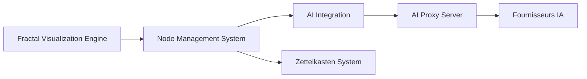

# satellitecomponent/Neurite

> Web mind-mapping workspace on a fractal background, with AI nodes and Zettelkasten memory.

## The problem
Organizing ideas and conversations with AIs in a linear interface loses the links between them.

## What it actually does
Web interface where you navigate the Mandelbrot set and place nodes: text, image, video, web page, PDF and AI agents connected to each other. Nodes are physically simulated; AI nodes exchange messages and read the connected graph. A Zettelkasten syncs with the map, with a local vector database. Providers: Ollama, transformers.js, OpenAI, Groq, Anthropic. Local servers for proxy, scraping, Wikipedia, Wolfram Alpha.

## How it is wired


## Trying it
No command is given in the README; the project points to a website and a Desktop version.
```bash
# aucune commande documentée dans le README
```

## Cost and gotchas
The code is free, cloud models require their keys. Desktop version is experimental: unsigned on macOS, warning on Windows. README warning about flashing lights.

## What it is not
Not a proven productivity tool: experimental interface, "Neural API" in trial. Security links between nodes and local servers are not described.

## Alternatives
- No alternative named in the README.

## For you
Ignore: a graphical curiosity with no clear use for a data/MLOps flow.
