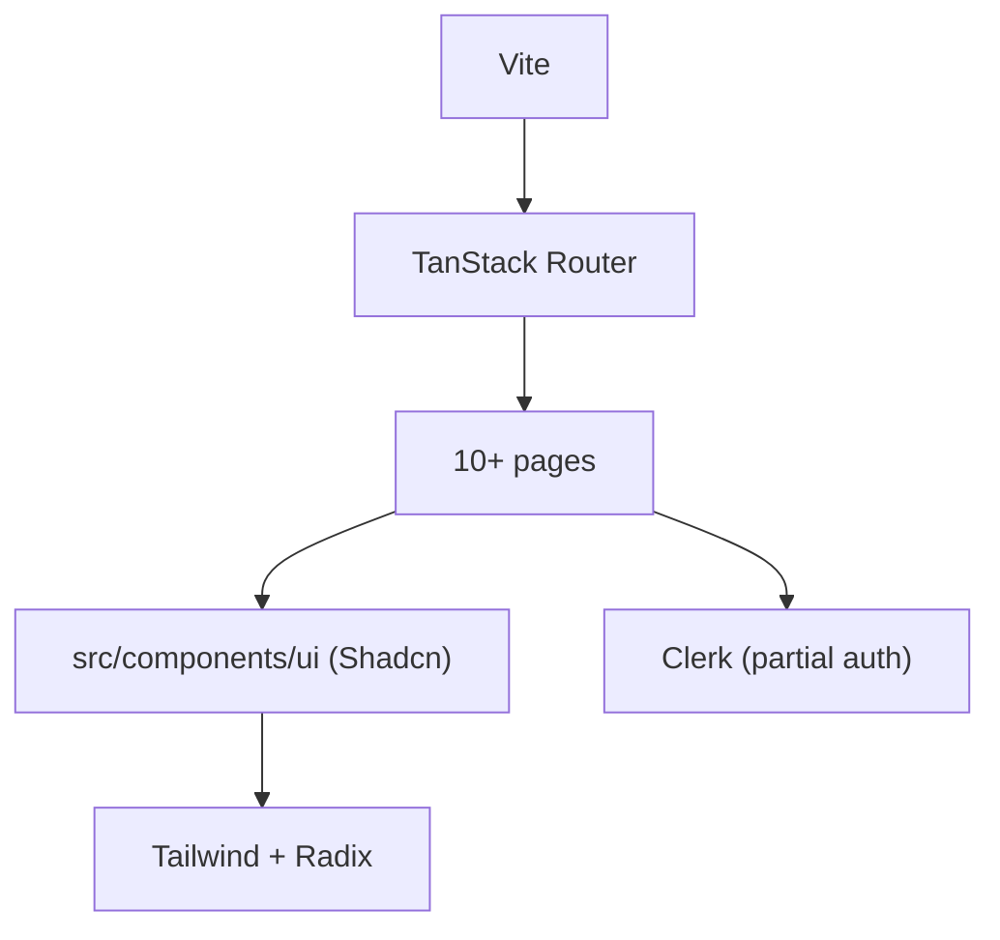

# satnaing/shadcn-admin

> A collection of dashboard interfaces in Shadcn and Vite, for front-end developers who want a starting point.

## The problem
Building an admin dashboard (sidebar, themes, typical pages) from scratch takes front-end time.

## What it actually does
Provides more than ten dashboard pages, light/dark mode, global search, RTL support, on ShadcnUI, Tailwind, Radix and TanStack Router. A few Shadcn components are modified for RTL. The author states that this is not a starter template. Clerk authentication is only partial.

## How it is wired


## Trying it
```bash
git clone https://github.com/satnaing/shadcn-admin.git
cd shadcn-admin
pnpm install
pnpm run dev
```

## Cost and gotchas
Free. Clerk, for the auth part, is a third-party service. Updating components via the Shadcn CLI may overwrite the components modified for RTL.

## What it is not
Not a starter nor a complete product: the author himself says he might make one later. No backend.

## Alternatives
No alternative named in the README.

## For you
Ignore for a data/MLOps profile: it is generic front-end, useful only if you need to quickly dress up an internal interface.
