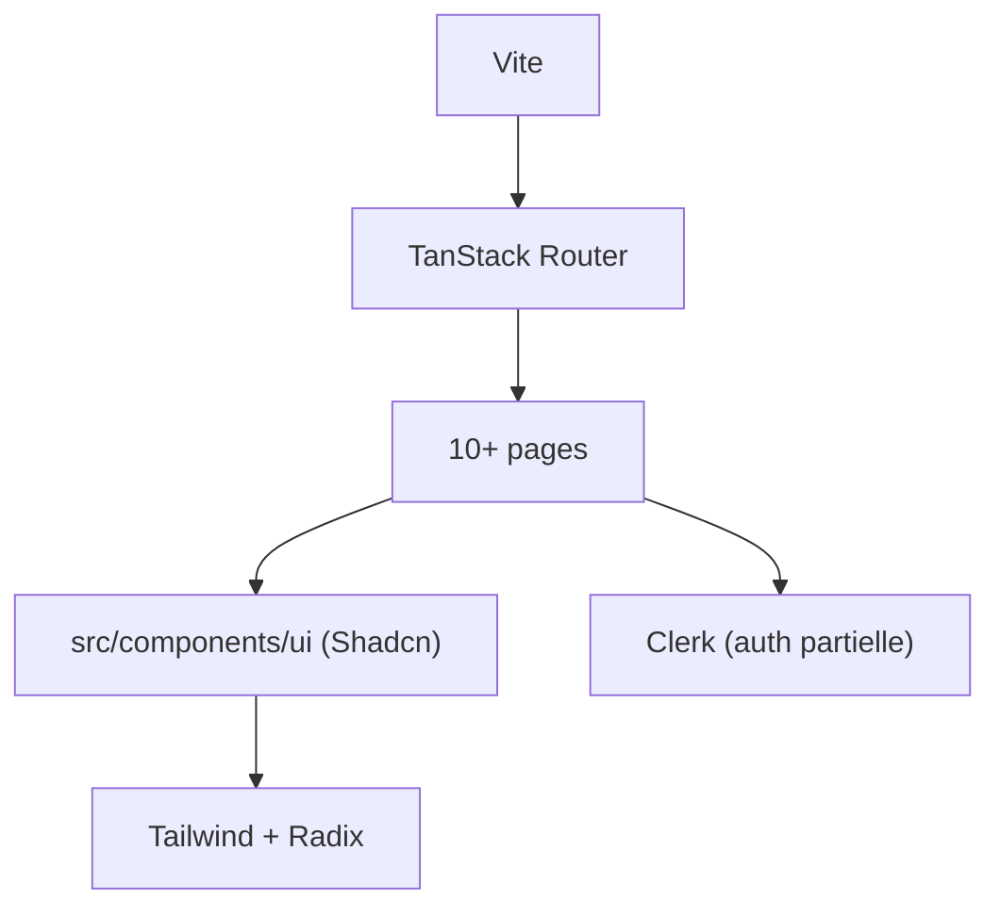

# satnaing/shadcn-admin

> Collection d'interfaces de tableau de bord en Shadcn et Vite, pour développeurs front qui veulent un point de départ.

## Le problème
Monter un tableau de bord d'administration (barre latérale, thèmes, pages types) from scratch prend du temps de front.

## Ce que ça fait vraiment
Fournit plus de dix pages de dashboard, mode clair/sombre, recherche globale, support RTL, sur ShadcnUI, Tailwind, Radix et TanStack Router. Quelques composants Shadcn sont modifiés pour le RTL. L'auteur précise que ce n'est pas un template de démarrage. L'authentification Clerk n'est que partielle.

## Comment c'est branché


## Essayer
```bash
git clone https://github.com/satnaing/shadcn-admin.git
cd shadcn-admin
pnpm install
pnpm run dev
```

## Coût et pièges
Gratuit. Clerk, pour la partie auth, est un service tiers. Mettre à jour les composants via la CLI Shadcn peut écraser les composants modifiés pour le RTL.

## Ce que ce n'est pas
Pas un starter ni un produit complet : l'auteur dit lui-même qu'il pourrait en faire un plus tard. Pas de backend.

## Alternatives
Aucune alternative nommée dans le README.

## Pour toi
À ignorer pour un profil data/MLOps : c'est du front générique, utile seulement si tu dois habiller vite une interface interne.

