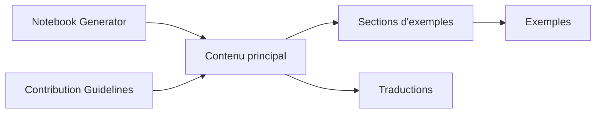

# satwikkansal/wtfpython

> Collection of confusing Python examples, explained, to deepen your grasp of how the language works.

## The problem
Some Python behaviors surprise even seasoned users (object identity, scope, mutability) and cause bugs that are hard to understand.

## What it actually does
Each example follows the same template: setup code, unexpected output, then an explanation. Sections: "Strain your brain", "Slippery Slopes", "The Hidden treasures", "Appearances are deceptive", "Miscellaneous". Translations exist, as well as an interactive site and a Jupyter notebook. The examples are tested on Python 3.5.2, with versions specified when the result differs.

## How it is wired


## Trying it
```bash
# Aucune commande d'installation dans le README : lire les exemples dans l'ordre.
# Exemple montré :
# >>> a, b = 257, 257
# >>> a is b
```

## Cost and gotchas
Free. Some results vary depending on the Python version or interactive mode; the repository specifies this case by case.

## What it is not
Not a best-practices manual or a structured course; some examples are outdated (Python 2, earlier than 3.7), and the README says so.

## Alternatives
No alternative named in the README.

## For you
Worth adopting: an hour of reading prevents subtle bugs (mutable arguments, closures in loops, `is` versus `==`) in your Python pipeline code.
