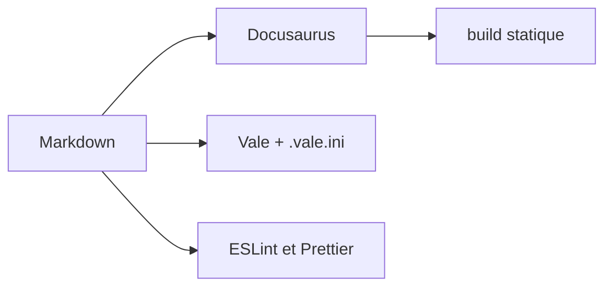

# saucelabs/sauce-docs

> Source of the Sauce Labs technical documentation site, built with Docusaurus.

## The problem
Maintaining Sauce Labs product documentation as code, reviewed and checked.

## What it actually does
A Docusaurus site (Node 18 or later) with ESLint and Prettier linting before commit, and Vale as a prose linter with the `styles/sauce` rules configured by `.vale.ini`. The local server works without an Algolia key (`npm run dev`) or with one (`npm run start`).

## How it is wired
Simplified diagram based on the sheet, no diagram provided.


## Trying it
```bash
git clone https://github.com/saucelabs/sauce-docs.git
cd sauce-docs
npm install
npm run dev
npm run build
npm run serve
```

## Cost and gotchas
Node 18 minimum; Docker optional. Full search requires an Algolia key.

## What it is not
Not a reusable tool: the content is Sauce Labs'. Only the Docusaurus and Vale toolchain can serve as a model.

## Alternatives
None named in the README.

## For you
Ignore: documentation for a web testing product; only the Vale toolchain example can inspire a documentation project.
