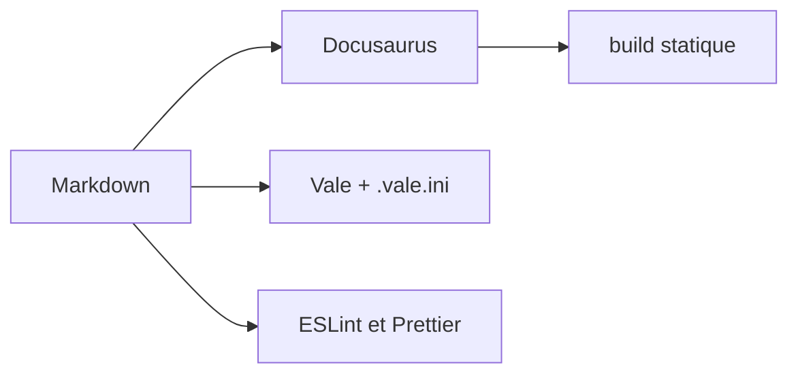

# saucelabs/sauce-docs

> Source du site de documentation technique de Sauce Labs, construit avec Docusaurus.

## Le problème
Maintenir la documentation produit de Sauce Labs sous forme de code, relue et vérifiée.

## Ce que ça fait vraiment
Site Docusaurus (Node 18 ou plus) avec lint ESLint et Prettier avant commit, et Vale comme linter de prose avec les règles `styles/sauce` configurées par `.vale.ini`. Le serveur local fonctionne sans clé Algolia (`npm run dev`) ou avec (`npm run start`).

## Comment c'est branché
Schéma simplifié d'après la fiche, sans diagramme fourni.


## Essayer
```bash
git clone https://github.com/saucelabs/sauce-docs.git
cd sauce-docs
npm install
npm run dev
npm run build
npm run serve
```

## Coût et pièges
Node 18 minimum ; Docker optionnel. La recherche complète demande une clé Algolia.

## Ce que ce n'est pas
Pas un outil réutilisable : le contenu est celui de Sauce Labs. Seule la chaîne Docusaurus et Vale peut servir de modèle.

## Alternatives
Aucune nommée dans le README.

## Pour toi
À ignorer : documentation d'un produit de test web ; seul l'exemple de chaîne Vale peut inspirer un projet de doc.

