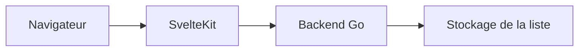

# sbondCo/Watcharr

> Self-hosted list of watched movies, series and anime, with ratings and statuses.

## The problem
Keeping track of what you have watched, wanted to watch or dropped, without depending on a third-party service.

## What it actually does
Web application written in Go and Svelte(Kit) that stores movies, series and anime with a rating and a status. With extra configuration, it also tracks video games. A public demo is offered. Installation goes through a `docker-compose.yml` and external documentation.

## How it is wired

Simplified diagram based on the sheet, no diagram provided.

## Trying it
No command in the README: installation is deferred to the documentation and a `docker-compose.yml` file.

## Cost and gotchas
Free, with Docker. Video game tracking requires additional configuration. The README mentions possible bugs on the demo version.

## What it is not
Not a media player nor a streaming server: only a tracking list. Unrelated to AI or data.

## Alternatives
No alternative named in the README.

## For you
Ignore for your data / AI profile: it is a personal leisure tool, off-topic professionally.
