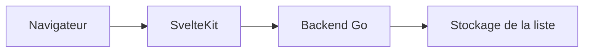

# sbondCo/Watcharr

> Liste auto-hébergée de films, séries et animés vus, avec notes et statuts.

## Le problème
Garder une trace de ce qu'on a regardé, voulu voir ou abandonné, sans dépendre d'un service tiers.

## Ce que ça fait vraiment
Application web écrite en Go et Svelte(Kit) qui stocke films, séries et animés avec note et statut. Avec une configuration supplémentaire, elle suit aussi les jeux vidéo. Une démo publique est proposée. L'installation passe par un `docker-compose.yml` et une documentation externe.

## Comment c'est branché

Schéma simplifié d'après la fiche, sans diagramme fourni.

## Essayer
Aucune commande dans le README : l'installation est renvoyée à la documentation et à un fichier `docker-compose.yml`.

## Coût et pièges
Gratuit, avec Docker. Le suivi des jeux vidéo demande une configuration en plus. Le README mentionne des bugs possibles sur la version de démo.

## Ce que ce n'est pas
Pas un lecteur multimédia ni un serveur de streaming : seulement une liste de suivi. Sans lien avec l'IA ou les données.

## Alternatives
Aucune alternative nommée dans le README.

## Pour toi
À ignorer pour ton profil data / IA : c'est un outil personnel de loisirs, hors sujet professionnel.

