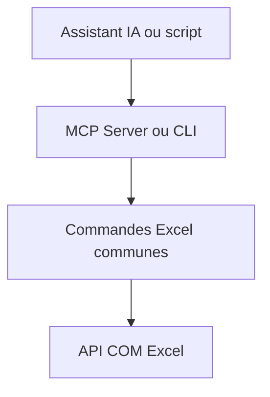

# sbroenne/mcp-server-excel

> MCP server and CLI that drive the real Microsoft Excel through its COM API, for AI agents on Windows.

## The problem
Tools that only read Excel files recalculate nothing and lose Power Query, pivot tables and macros.

## What it actually does
Claims 64 MCP tools covering 437 operations: Power Query, DAX, Power Pivot, tables, pivot tables, charts, slicers, VBA, Python `=PY()`, Goal Seek. Excel does the work and you see the result live. Two equivalent entry points: an MCP server (tool discovery, persistent sessions) or the `excelcli` CLI (often fewer tokens).

## How it is wired


## Trying it
```powershell
copilot plugin install excel-mcp@awesome-copilot
copilot plugin install excel-cli@awesome-copilot
```

## Cost and gotchas
Free, but requires Windows, Microsoft Excel 2016 or later (license at your expense) and an interactive desktop. An agent can modify real workbooks and run VBA macros: work on copies.

## What it is not
Not usable on Linux, macOS or for server-side batch processing. Not a file reader: it requires an open Excel instance.

## Alternatives
No named alternative in the README (PowerPoint MCP Server is a sibling project by the same author).

## For you
Worth watching: useful if your analyses go through complex Excel workbooks on Windows, useless otherwise.
