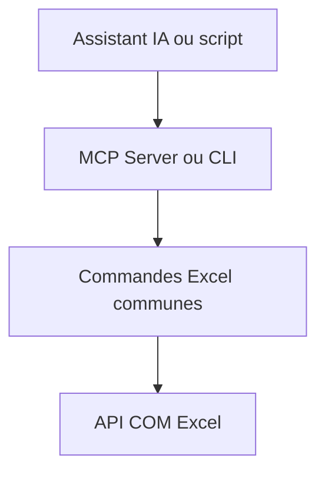

# sbroenne/mcp-server-excel

> Serveur MCP et CLI qui pilotent le vrai Microsoft Excel via son API COM, pour agents IA sous Windows.

## Le problème
Les outils qui lisent seulement les fichiers Excel ne recalculent rien et perdent Power Query, tableaux croisés et macros.

## Ce que ça fait vraiment
Revendique 64 outils MCP couvrant 437 opérations : Power Query, DAX, Power Pivot, tableaux, tableaux croisés, graphiques, segments, VBA, Python `=PY()`, Goal Seek. Excel fait le travail, tu vois le résultat en direct. Deux entrées équivalentes : serveur MCP (découverte d'outils, sessions persistantes) ou CLI `excelcli` (souvent moins de jetons).

## Comment c'est branché


## Essayer
```powershell
copilot plugin install excel-mcp@awesome-copilot
copilot plugin install excel-cli@awesome-copilot
```

## Coût et pièges
Gratuit, mais exige Windows, Microsoft Excel 2016 ou plus (licence à ta charge) et un bureau interactif. Un agent peut modifier des classeurs réels et lancer des macros VBA : travaille sur des copies.

## Ce que ce n'est pas
Pas utilisable sous Linux, macOS ni en traitement serveur par lots. Pas un lecteur de fichiers : il exige une instance Excel ouverte.

## Alternatives
Aucune alternative nommée dans le README (PowerPoint MCP Server est un projet frère du même auteur).

## Pour toi
À surveiller : utile si tes analyses passent par des classeurs Excel complexes sous Windows, inutile sinon.

