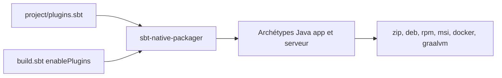

# sbt/sbt-native-packager

> sbt plugin that packages a Scala or Java application into native formats, for JVM developers.

## The problem
Shipping a JVM application as an installable package (deb, rpm, msi, Docker image) takes a lot of homemade scripts.

## What it actually does
Adds archetypes to sbt (Java application, server application with systemd, systemv or upstart). Produces zip, tar.gz and xz archives, deb, rpm, dmg and msi packages, Docker images and GraalVM native images. Optionally integrates JDeb and Spotify's Docker client.

## How it is wired

Simplified diagram based on the sheet, no diagram provided.

## Trying it
```bash
sbt Universal/packageBin
sbt Debian/packageBin
sbt Rpm/packageBin
sbt Docker/publishLocal
sbt GraalVMNativeImage/packageBin
```

## Cost and gotchas
Free. You need an sbt project, and the compatibility matrix determines which packages are possible depending on your system.

## What it is not
Not a deployment or orchestration tool: it only builds packages. It is only for sbt projects.

## Alternatives
`sbt-assembly`: single jar. `sbt-docker`: more customization of Docker images than the built-in Docker plugin.

## For you
Ignore unless you package Scala or Java services with sbt: for Python projects, it brings nothing.
