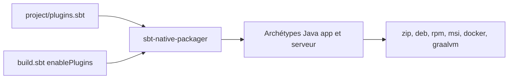

# sbt/sbt-native-packager

> Plugin sbt qui empaquette une application Scala ou Java en formats natifs, pour développeurs JVM.

## Le problème
Livrer une application JVM sous forme de paquet installable (deb, rpm, msi, image Docker) demande beaucoup de scripts maison.

## Ce que ça fait vraiment
Ajoute à sbt des archétypes (application Java, application serveur avec systemd, systemv ou upstart). Produit des archives zip, tar.gz et xz, des paquets deb, rpm, dmg, msi, des images Docker et des images natives GraalVM. Intègre en option JDeb et le client Docker de Spotify.

## Comment c'est branché

Schéma simplifié d'après la fiche, sans diagramme fourni.

## Essayer
```bash
sbt Universal/packageBin
sbt Debian/packageBin
sbt Rpm/packageBin
sbt Docker/publishLocal
sbt GraalVMNativeImage/packageBin
```

## Coût et pièges
Gratuit. Il faut un projet sbt, et la matrice de compatibilité détermine quels paquets sont possibles selon ton système.

## Ce que ce n'est pas
Pas un outil de déploiement ni d'orchestration : il fabrique des paquets seulement. Il ne sert qu'aux projets sbt.

## Alternatives
`sbt-assembly` : jar unique. `sbt-docker` : plus de personnalisation des images Docker que le plugin Docker intégré.

## Pour toi
À ignorer sauf si tu packages des services Scala ou Java avec sbt : pour des projets Python, il n'apporte rien.

