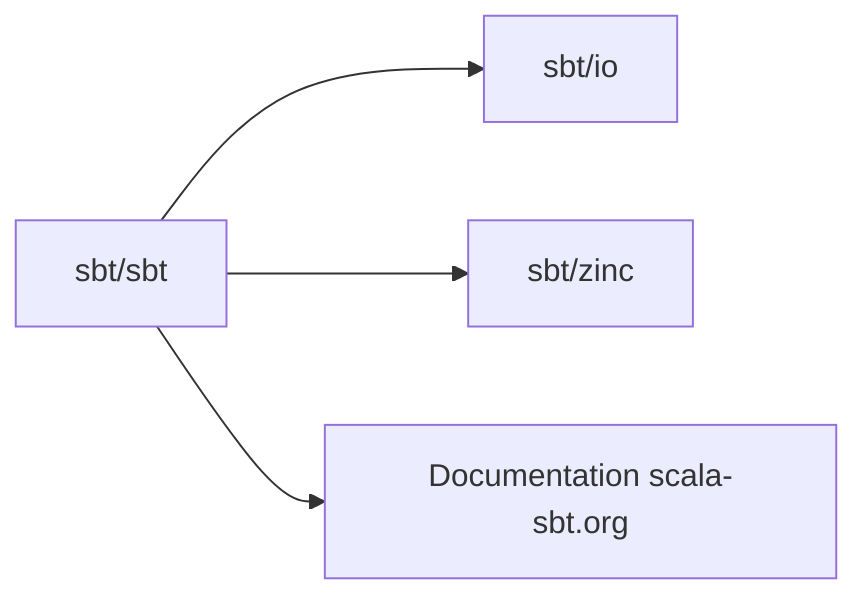

# sbt/sbt

> Build tool for Scala, Java and more, 2.x series; this repository hosts the build's modules.

## The problem
Compiling, testing and packaging Scala/Java projects with dependency resolution and incremental compilation.

## What it actually does
The code is spread over several repositories: `sbt/io` (the sbt.io module), `sbt/zinc` (Scala incremental compiler) and `sbt/sbt` (the tool's modules). The README points to the docs, the FAQ and CONTRIBUTING, and contains no command or example.

## How it is wired

## Trying it
No command in the README: see the "Setup" page of the documentation.

## Cost and gotchas
Free. Read CONTRIBUTING before any issue or PR. Part of the history is in sbt-zero-seven (0.7.7 and earlier).

## What it is not
Not a usage guide: the README is minimal and points to the documentation, the FAQ and CONTRIBUTING. Not a tool for languages other than Scala and Java.

## Alternatives
No alternative named.

## For you
Ignore: it only concerns a Scala/JVM build, for example Spark, where you will not go into the tool's code.
