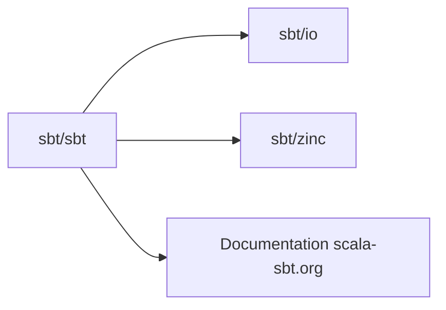

# sbt/sbt

> Outil de build pour Scala, Java et plus, série 2.x ; ce dépôt héberge les modules du build.

## Le problème
Compiler, tester et empaqueter des projets Scala/Java avec résolution de dépendances et compilation incrémentale.

## Ce que ça fait vraiment
Le code est réparti sur plusieurs dépôts : `sbt/io` (module sbt.io), `sbt/zinc` (compilateur incrémental Scala) et `sbt/sbt` (modules de l'outil). Le README renvoie à la doc, à la FAQ et à CONTRIBUTING, et ne contient ni commande ni exemple.

## Comment c'est branché

## Essayer
Aucune commande dans le README : voir la page « Setup » de la documentation.

## Coût et pièges
Gratuit. Lire CONTRIBUTING avant toute issue ou PR. Une partie de l'historique est dans sbt-zero-seven (0.7.7 et avant).

## Ce que ce n'est pas
Pas un guide d'usage : README minimal.

## Alternatives
Aucune alternative nommée.

## Pour toi
Ignorer : concerne seulement un build Scala/JVM, par exemple Spark, où tu n'iras pas dans le code de l'outil.

