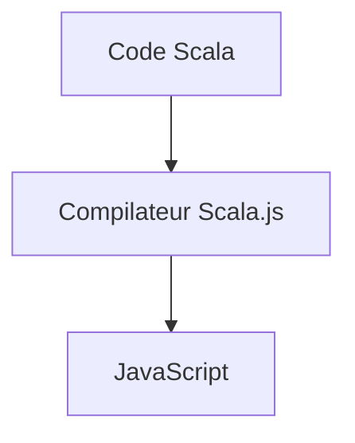

# scala-js/scala-js

> Scala to JavaScript compiler, for Scala developers.

## The problem
Writing Scala code that runs in a browser or under Node.

## What it actually does
The README only says this is the repo of the Scala to JavaScript compiler and points to the development documentation, the contribution guide and a Discord server. No detail on how it works is given.

## How it is wired
Simplified diagram based on the sheet, no diagram provided.

## Trying it
No documented command.

## Cost and gotchas
Free. Insufficient material: nothing on installation or compatibility.

## What it is not
Not a web framework: a compiler. The rest is not described.

## Alternatives
No alternative named in the README.

## For you
Ignore: concerns Scala, outside your usual data and AI stack.
