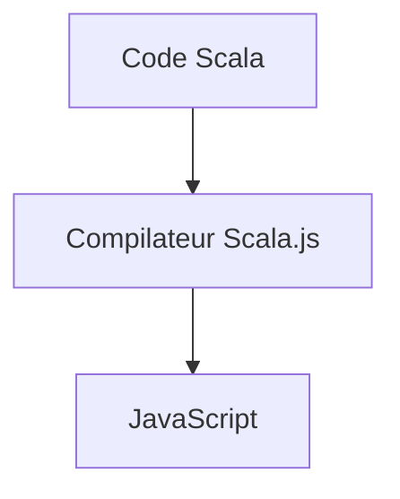

# scala-js/scala-js

> Compilateur de Scala vers JavaScript, pour développeurs Scala.

## Le problème
Écrire du code Scala qui s'exécute dans un navigateur ou sous Node.

## Ce que ça fait vraiment
Le README dit seulement que c'est le dépôt du compilateur Scala vers JavaScript et renvoie à la documentation de développement, au guide de contribution et à un salon Discord. Aucun détail de fonctionnement n'est fourni.

## Comment c'est branché
Schéma simplifié d'après la fiche, sans diagramme fourni.

## Essayer
Aucune commande documentée.

## Coût et pièges
Gratuit. Matière insuffisante : rien sur l'installation ni la compatibilité.

## Ce que ce n'est pas
Pas un framework web : un compilateur. Le reste n'est pas décrit.

## Alternatives
Aucune alternative nommée dans le README.

## Pour toi
Ignorer : concerne Scala, hors de ta pile data et IA habituelle.

