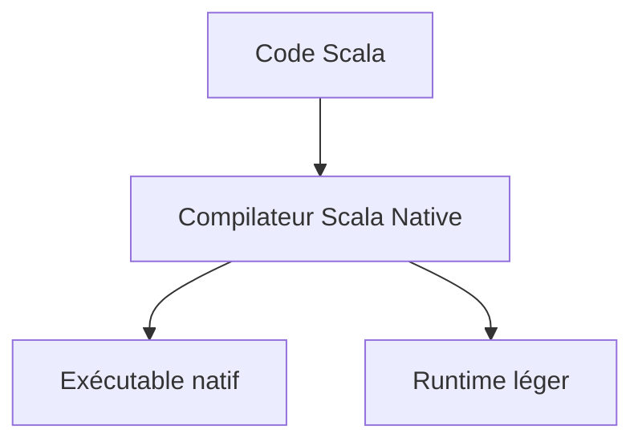

# scala-native/scala-native

> Ahead-of-time optimizing Scala compiler, with a lightweight runtime, for Scala developers.

## The problem
Producing native executables from Scala, without a Java virtual machine.

## What it actually does
The README announces an ahead-of-time optimizing compiler and a lightweight managed runtime, designed for Scala. It points to scala-native.org for getting started and documentation, and to Discord. No technical detail.

## How it is wired
Simplified diagram based on the sheet, no diagram provided.

## Trying it
No documented command: see scala-native.org.

## Cost and gotchas
Free. License detected but not identified by GitHub: to be checked. Insufficient material, 382 open issues.

## What it is not
Not a Python tool nor a detailed alternative to the JVM in this README.

## Alternatives
No alternative named in the README.

## For you
Ignore: serves Scala developers, which falls outside your data and AI stack.
