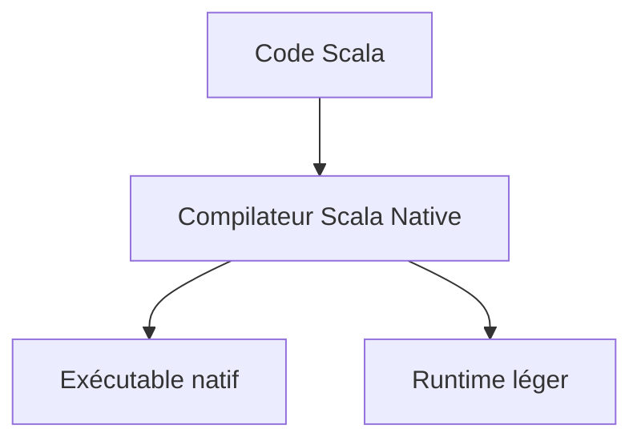

# scala-native/scala-native

> Compilateur Scala optimisant en avance de temps, avec un runtime léger, pour développeurs Scala.

## Le problème
Produire des exécutables natifs depuis Scala, sans machine virtuelle Java.

## Ce que ça fait vraiment
Le README annonce un compilateur optimisant en avance de temps et un runtime léger géré, conçus pour Scala. Il renvoie à scala-native.org pour le démarrage et la documentation, et à Discord. Aucun détail technique.

## Comment c'est branché
Schéma simplifié d'après la fiche, sans diagramme fourni.

## Essayer
Aucune commande documentée : voir scala-native.org.

## Coût et pièges
Gratuit. Licence détectée mais non identifiée par GitHub : à vérifier. Matière insuffisante, 382 issues ouvertes.

## Ce que ce n'est pas
Pas un outil Python ni une alternative à la JVM détaillée dans ce README.

## Alternatives
Aucune alternative nommée dans le README.

## Pour toi
Ignorer : sert aux développeurs Scala, ce qui sort de ta pile data et IA.

