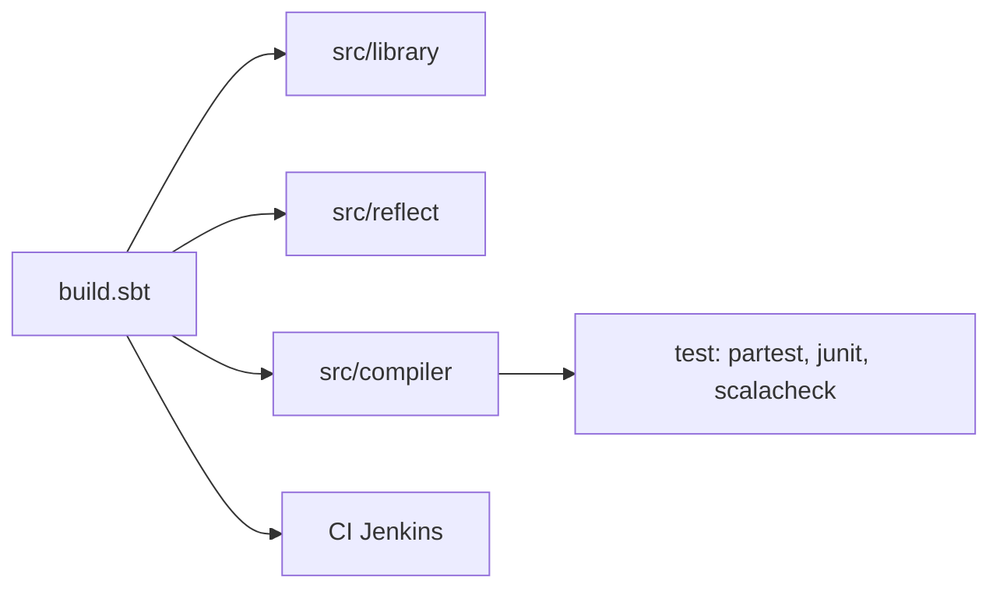

# scala/scala

> Repository of the Scala 2 compiler, standard library and spec, for its contributors.

## The problem
Maintaining and evolving Scala 2 (2.12.x and 2.13.x branches) with a bootstrapped build and CI.

## What it actually does
Contains `library`, `reflect`, `compiler`, the REPL, scaladoc, partest and the spec. The README mostly describes how to contribute: CLA, branches, sbt build, bootstrap with `restarrFull`, Jenkins CI with "mergely" builds. An LLM usage policy is mentioned.

## How it is wired


## Trying it
```bash
sbt
> compile
> junit/test
> restarrFull
```

## Cost and gotchas
Java 8 as the baseline (17 or 21 accepted locally), sbt; Windows via Cygwin only. A CLA is required to contribute. Issues go to scala/bug.

## What it is not
Not Scala 3 (see scala/scala3). Not a tutorial on using the language.

## Alternatives
scala/scala3 for Scala 3, cited by the README.

## For you
Ignore, unless you maintain Spark code in Scala 2: then read the branch matrix; otherwise it is a contributors' repository.
