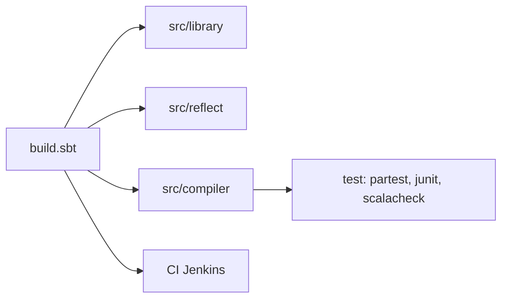

# scala/scala

> Dépôt du compilateur, de la bibliothèque standard et de la spec de Scala 2, pour ses contributeurs.

## Le problème
Maintenir et faire évoluer Scala 2 (branches 2.12.x et 2.13.x) avec un build bootstrapé et une CI.

## Ce que ça fait vraiment
Contient `library`, `reflect`, `compiler`, REPL, scaladoc, partest et la spec. Le README décrit surtout comment contribuer : CLA, branches, build sbt, bootstrap avec `restarrFull`, CI Jenkins avec builds « mergely ». Politique d'usage des LLM mentionnée.

## Comment c'est branché


## Essayer
```bash
sbt
> compile
> junit/test
> restarrFull
```

## Coût et pièges
Java 8 de base (17 ou 21 acceptés en local), sbt ; Windows via Cygwin seulement. CLA obligatoire pour contribuer. Les issues vont sur scala/bug.

## Ce que ce n'est pas
Pas Scala 3 (voir scala/scala3). Pas un tutoriel d'usage du langage.

## Alternatives
scala/scala3 pour Scala 3, cité par le README.

## Pour toi
Ignorer, sauf si tu maintiens du Spark en Scala 2 : lire alors la matrice de branches, sinon c'est un dépôt de contributeurs.

