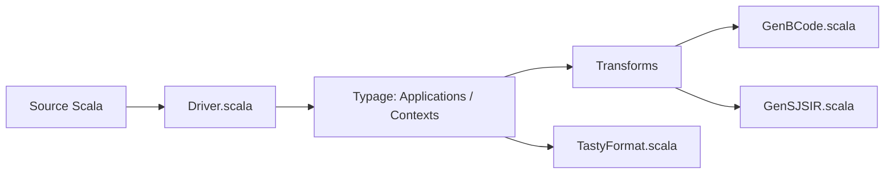

# scala/scala3

> Compiler, standard library and specification of the Scala 3 language, for language developers.

## The problem
This repository is where Scala 3 is built; without it, no up-to-date compiler or stdlib.

## What the README is not
The README is very short: it points to the documentation and describes how to build a local distribution.

## What it actually does
From the code: compilation driver, parsing, typing, transformations, JVM (`GenBCode`) and Scala.js (`GenSJSIR`) backends, TASTy format, standard library, REPL, Scaladoc, SemanticDB. The exact orchestration of the phases was not verified in the analysis.

## How it is wired


## Trying it
```bash
sbt dist/Universal/packageBin
```
The distributions appear in `dist/target/`.

## Cost and gotchas
Free; the build goes through sbt. Explicit policy on the use of LLM tools for contributing.

## What it is not
Not a guide for learning Scala: the README points to external documentation.

## Alternatives
No alternative named in the README.

## For you
Worth watching only: Scala remains present on the Spark side, but this repository is only of interest if you contribute to the compiler.
