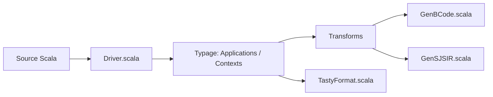

# scala/scala3

> Compilateur, bibliothèque standard et spécification du langage Scala 3, pour développeurs du langage.

## Le problème
Ce dépôt est le lieu où Scala 3 est construit ; sans lui, pas de compilateur ni de stdlib à jour.

## Ce que ce n'est pas le README
Le README est très court : il renvoie à la documentation et décrit la construction d'une distribution locale.

## Ce que ça fait vraiment
D'après le code : driver de compilation, analyse syntaxique, typage, transformations, backends JVM (`GenBCode`) et Scala.js (`GenSJSIR`), format TASTy, bibliothèque standard, REPL, Scaladoc, SemanticDB. L'orchestration exacte des phases n'est pas vérifiée dans l'analyse.

## Comment c'est branché


## Essayer
```bash
sbt dist/Universal/packageBin
```
Les distributions apparaissent dans `dist/target/`.

## Coût et pièges
Gratuit ; la compilation passe par sbt. Politique explicite sur l'usage d'outils LLM pour contribuer.

## Ce que ce n'est pas
Pas un guide d'apprentissage de Scala : le README renvoie à la documentation externe.

## Alternatives
Aucune alternative nommée dans le README.

## Pour toi
À surveiller seulement : Scala reste présent côté Spark, mais ce dépôt n'intéresse que si tu contribues au compilateur.

