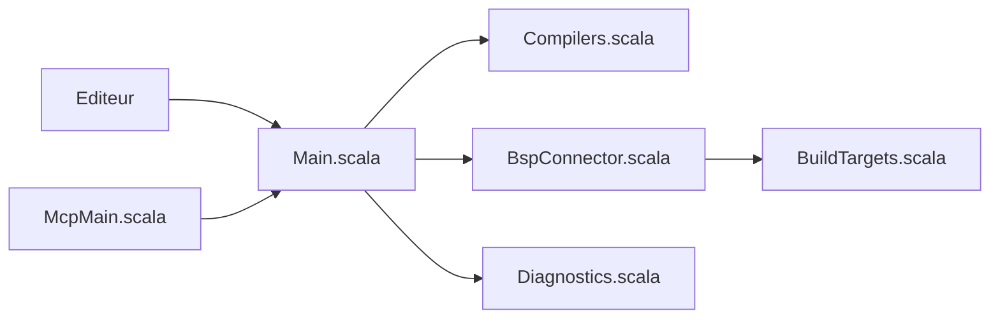

# scalameta/metals

> Scala language server (LSP) for using Scala in any compatible editor.

## The problem
A full IDE is needed to get completion, definitions and diagnostics in Scala.

## What it actually does
The README is very short and points to the scalameta.org/metals site. Based on the architecture: an LSP server routes requests to presentation compilers (completion, definitions, references, diagnostics, actions), relies on SemanticDB indexing and BSP connections to build tools. An MCP mode exists for querying from tools.

## How it is wired


## Trying it
```bash
# Aucune commande dans le README : voir https://scalameta.org/metals/
```

## Cost and gotchas
Free. Installation details are not documented in the README.

## What it is not
Not an IDE: it is a backend to plug into an editor.

## Alternatives
IntelliJ IDEA, cited in the README: the most widespread IDE, with a reimplemented typechecker.

## For you
Worth watching: useful if you write Scala/Spark in VS Code or Neovim, of no interest otherwise.
